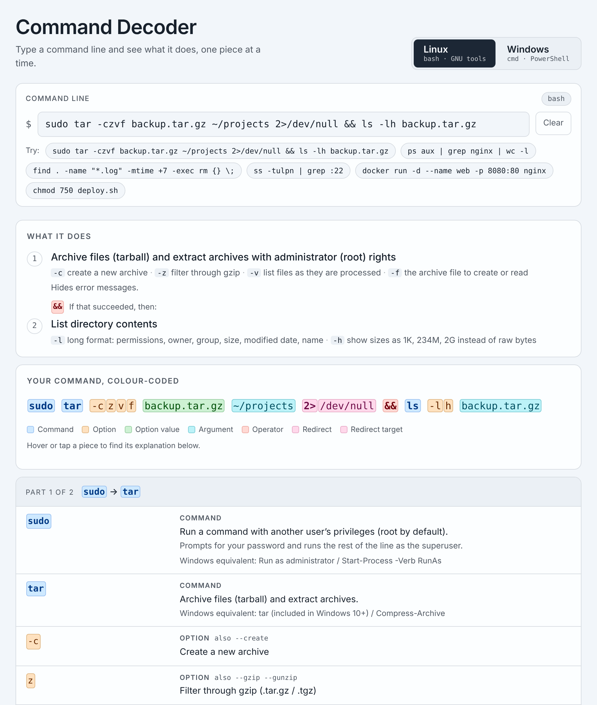

# Command Decoder

Type a Linux or Windows command line and see what it does, one piece at a time.

Command Decoder splits a command into its parts (the program, subcommands, options, option values, arguments, pipes and redirects), colour-codes each part, and explains it in plain English. Pick **Linux** or **Windows** from the menu at the top. It runs entirely in your browser as a single static HTML file, with no build step, no dependencies and no server.

## Features

- **Linux / Windows switch.** Linux explains bash commands. Windows explains both Command Prompt (`cmd.exe`) and PowerShell, and detects which one you typed.
- **Plain-English summary.** A numbered list of what the command line does, with connectors such as "If that succeeded, then" and "Then its output is piped into".
- **Colour-coded command line.** Command, subcommand, option, option value, argument, operator, redirect and unrecognised pieces each get their own colour. Hover or tap a piece to jump to its explanation.
- **Combined options are split.** `tar -czvf` is explained as `-c`, `-z`, `-v` and `-f`; `netstat -ano` as `-a`, `-n` and `-o`.
- **Pipes, chains and redirects.** `|`, `&&`, `||`, `;`, `&`, `>`, `>>`, `<`, `2>/dev/null`, `2>&1`, plus `$VARIABLES`, globs, quoting and `~`.
- **Wrapper commands.** `sudo`, `xargs`, `nohup`, `time`, `watch`, `env` and `find ... -exec ... \;` are followed through to the command they run.
- **Subcommands.** `git`, `docker` (including `compose`), `ip`, `systemctl`, `apt`, `netsh`, `reg`, `sc` and others are explained down to the subcommand level.
- **PowerShell aware.** Cmdlets, aliases, `-Parameter` names, script blocks (`{ $_.Length -gt 1MB }`) and comparison operators.
- **Safety warnings.** Risky patterns such as `rm -rf /`, `dd` onto a disk, `mkfs`, `curl | sh`, `chmod 777`, `git push --force`, `format`, `del /s`, `rd /s`, `reg delete` and encoded PowerShell commands show a warning banner.
- **Helpful when it does not know.** Unknown commands are marked as such with "did you mean" suggestions. If you type a Windows command in Linux mode (or the reverse), it offers a one-click switch.
- **Equivalents.** Many commands list their counterpart on the other system, for example `ls` and `dir`, or `ss` and `netstat -ano`.
- **Command library.** A collapsible list of every command it can explain on the selected system.
- **Light and dark themes** that follow your system setting, and a layout that works on phones.

## Use it

Open `index.html` in any modern browser, choose **Linux** or **Windows**, and type a command.

## Examples

| Mode | Command | What you see |
| --- | --- | --- |
| Linux | `sudo tar -czvf backup.tar.gz ~/projects 2>/dev/null && ls -lh backup.tar.gz` | Two steps. The first runs `tar` with administrator rights and creates a gzip-compressed archive, hiding error messages. `ls` runs only if `tar` succeeded. |
| Linux | `ps aux \| grep nginx \| wc -l` | A three-stage pipeline, each stage explained, with the pipes joining them. |
| Linux | `find . -name "*.log" -mtime +7 -exec rm {} \;` | A search for `.log` files older than 7 days, followed by `rm` on each match. |
| Linux | `git commit -am "fix" && git push --force` | Both subcommands explained, plus a warning about the force push. |
| Windows | `netstat -ano \| findstr :443` | `netstat` with `-a -n -o` split out, piped into `findstr`. |
| Windows | `Get-ChildItem -Recurse -Filter *.log \| Where-Object { $_.Length -gt 1MB }` | Detected as PowerShell. The script block and the `-gt` operator are explained. |
| Windows | `netsh wlan show profile name="HomeWiFi" key=clear` | `netsh` followed through `wlan`, `show` and `profile`, with the `name=` and `key=` settings explained. |

## What it covers

About 165 Linux commands and about 190 Windows commands and cmdlets, with extra depth on everyday system administration and networking.

- **Files and text:** `ls`, `cp`, `mv`, `rm`, `find`, `grep`, `sed`, `awk`, `sort`, `tar`, `chmod`, `dir`, `robocopy`, `findstr`, `icacls`, `Get-ChildItem`, `Select-String` and similar.
- **Processes and services:** `ps`, `top`, `kill`, `systemctl`, `journalctl`, `tasklist`, `taskkill`, `sc`, `Get-Process`, `Get-Service` and similar.
- **Networking:** `ping`, `ip`, `ss`, `netstat`, `curl`, `ssh`, `scp`, `rsync`, `dig`, `traceroute`, `nmap`, `tcpdump`, `iptables`, `ufw`, `ipconfig`, `tracert`, `netsh`, `route`, `Test-NetConnection`, `Resolve-DnsName` and similar.
- **Packages and tooling:** `apt`, `dnf`, `pacman`, `pip`, `npm`, `winget`, `git`, `docker`, `make`.
- **System and disks:** `mount`, `fdisk`, `dd`, `chkdsk`, `sfc`, `dism`, `reg`, `shutdown`, `schtasks`, `wsl`.

The "Commands I can explain" panel in the page lists them all.

## How it works

1. **Tokenizer.** Splits the line into words and operators. It understands quotes, escapes, `$(...)` and backticks in bash, `%VAR%` in `cmd.exe`, and `{ }` script blocks in PowerShell.
2. **Parser.** Looks up the command in the built-in reference, then walks the remaining words: options (including combined short options such as `-czvf`), option values, subcommands, wrapped commands and positional arguments. Redirects are attached to the command they belong to.
3. **Reference data.** Each command is a short entry listing its options, arguments and subcommands.
4. **Renderer.** Builds the summary, the colour-coded line and the per-piece breakdown, and links them so hovering one highlights the other.

Everything lives in `index.html`. Each section of the script starts with a `/* ====== ... ====== */` banner: command reference helpers, Linux commands, Windows commands, PowerShell cmdlets, tokenizer, explainer and UI.

## Limitations

- It explains single command lines from a built-in reference. It does not run anything and does not read your system's `man` pages, so it only knows the commands and options that have been written into it.
- Options of a command it does not know are marked as unrecognised rather than guessed. For anything important, check `man <command>` or `<command> --help` on Linux, and `<command> /?` or `Get-Help <command>` on Windows.
- It is not a full shell parser. Loops, conditionals, functions, here-documents and the text inside `cmd /c "..."` or `bash -c "..."` are not interpreted.
- On Windows, the choice between `cmd.exe` and PowerShell is inferred from the syntax. A line that could be either is treated as `cmd.exe`.
- The safety warnings are pattern-based hints. They can miss dangerous commands and should not replace reading what you are about to run.

## Privacy

Nothing you type leaves the page. The only network request is the optional Google Fonts stylesheet (Inter, JetBrains Mono and Space Grotesk); without it the page falls back to your system fonts. The selected system (Linux or Windows) is remembered in your browser's local storage.

## Files

| File | Purpose |
| --- | --- |
| `index.html` | The whole application: markup, styles, command reference and logic |
| `screenshot.png` | Image used in this README |
| `README.md` | This file |
